<div align="center">
  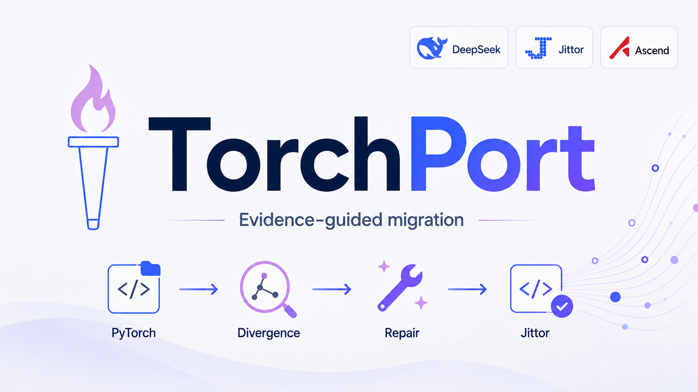

  <h1>TorchPort</h1>

  <p>
    <strong>面向全国产化 AI 软件栈的 PyTorch → Jittor 自动迁移与验证 Agent。</strong><br>
    TorchPort 以 DeepSeek/DSH 作为源代码分析与操作平台，支持 Pytorch、TensorFlow、Caffe 等框架到 Jittor 的迁移，
    并天然支持昇腾等国产算力硬件。
  </p>

  <p>
    
    
    
    
    
    
  </p>

  <p>
    中文 ·
    <a href="README_en.md">English</a>
  </p>

  <p>
    <a href="#系统架构">系统架构</a> ·
    <a href="#项目定位">项目定位</a> ·
    <a href="#快速开始">快速开始</a> ·
    <a href="#dsh-集成">DSH 集成</a> ·
    <a href="#实验图表">实验图表</a> ·
    <a href="#当前状态">当前状态</a>
  </p>
</div>

## 系统架构

<div align="center">
  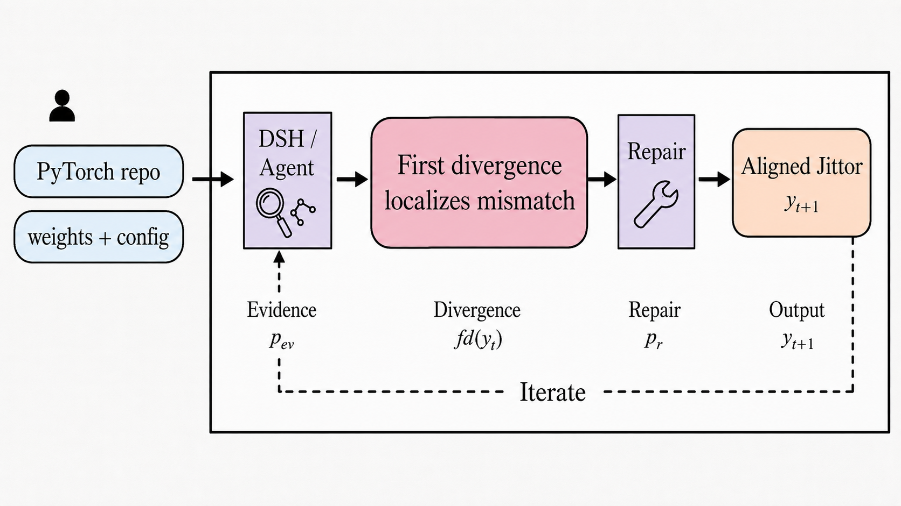
</div>

TorchPort 的核心假设很简单：模型迁移不能只看代码是否被替换，更要看迁移后的模型能否保持数值行为与性能对齐。

该智能体由两层组成。首先基于 DeepSeek/DSH 对未知 PyTorch 仓库做阅读、决策和修复调度，然后 TorchPort 提供确定性的扫描、迁移、双端执行、数值对齐和首次数值分歧定位工具。核心目标是构建一条从 DeepSeek、Jittor 到国产算力后端的全国产化模型迁移平台。

## 项目定位

TorchPort 关注的是一个可复验的问题：

```text
给定一个未知 PyTorch 仓库，
系统能否迁移到 Jittor，
实际运行 PyTorch 与 Jittor 两端，
比较同一输入和同一权重下的数值结果，
在不一致时定位首个分歧位置，
并把修复过程记录下来。
```

## 国产化路径


| 层次 | 当前选择 | 作用 |
| --- | --- | --- |
| 智能体入口 | DeepSeek/DSH | 读取未知仓库，决定迁移和修复动作 |
| 目标框架 | Jittor | 承接 PyTorch 代码与权重迁移 |
| 验证机制 | 双端执行 + 数值轨迹 | 判断迁移结果是否可信 |
| 后端方向 | 昇腾等国产算力 | 作为目标部署环境纳入接口设计 |

当前公开实验主要验证 PyTorch 到 Jittor 的迁移和数值一致性。昇腾等国产算力的完整端到端实验会在后续后端适配中补齐。

## 为什么需要 TorchPort

普通转换器主要回答一个问题：

```text
代码能不能转过去？
```

TorchPort 进一步回答：

```text
迁移后的项目能不能真正运行？
是否加载了相同权重？
是否使用了相同输入？
最终输出是否数值对齐？
如果不对齐，第一次从哪一层或哪一个算子开始偏离？
```

README 中使用的核心指标如下：

| 指标 | 含义 |
| --- | --- |
| `RN` | 迁移后的 Jittor 项目可以实际运行 |
| `NA` | PyTorch/Jittor 最终输出通过数值对齐 |
| `SA` | 中间层轨迹通过更严格的对齐检查 |
| `FD` | 首次数值分歧点 |
| `Cert` | 包含输入、权重、轨迹、误差和失败归因的数值证书 |

## 快速开始

```bash
python -m venv .venv
. .venv/bin/activate
python -m pip install -e ".[dev]"
```

运行基础检查：

```bash
pytest tests -q
ruff check .
python -m build
```

扫描并规划 PyTorch 仓库：

```bash
PYTHONPATH=src python -m torchport scan /path/to/pytorch-repo
PYTHONPATH=src python -m torchport plan /path/to/pytorch-repo --target jittor-native
```

执行一次自动迁移和验证：

```bash
PYTHONPATH=src python -m torchport auto /path/to/pytorch-repo \
  --output /path/to/migrated-jittor \
  --target jittor-native \
  --entrypoint main.py \
  --model main.Model \
  --shape 1,3,224,224 \
  --check-run
```

主报告写入：

```text
/path/to/migrated-jittor/.torchport/auto.json
```

## Workflow

```text
仓库扫描
      -> 模型入口
      -> 代码迁移
      -> PyTorch/Jittor 双端执行
      -> 权重与输入检查
      -> 张量轨迹比较
      -> 首次数值分歧定位
      -> 修复建议
      -> 再验证
```

TorchPort 在面对新仓库时，DSH 先读取仓库并调用 TorchPort 工具；TorchPort 返回结构化证据；DSH 再基于证据选择迁移或修复动作。

## DSH 集成

DSH 插件位于 `integrations/dsh`，目前提供 8 个工具：

```text
scan_repository
create_migration_plan
start_migration
run_verification
locate_first_divergence
propose_repairs
apply_verified_repair
generate_certification_report
```

运行插件测试：

```bash
cd integrations/dsh
npm install
npm test
```

## 当前状态

### 已公开

- [x] 开源仓库：核心 Python 包、命令行工具、测试、文档和实验图表已公开。
- [x] 转换插件：`integrations/dsh` 已提供 DSH 工具入口，覆盖扫描、迁移、验证、分歧定位和报告生成。
- [x] 模型测试：已整理 CNN、ViT、MAE、Swin、U-Net、SuperRes、VAE 等模型的对齐图和可视化结果。
- [x] 端到端样例：已公开 SuperRes 上的官方转换器对比和 DSH + TorchPort 迁移结果。

### 正在整理

- [ ] 统一基准：官方转换器、JTorch、纯 Codex、纯 DSH、DSH + TorchPort 的对比实验。
- [ ] 未见仓库：扩展真实 PyTorch 仓库测试集，验证系统对新项目的泛化能力。
- [ ] 昇腾实测：昇腾训练与后端适配结果暂未发布，整理完成后再进入公开结果。
- [ ] 发布准备：稳定 API、补全文档、整理首个 release 包。

## 实验图表

### 主实验图

<div align="center">
  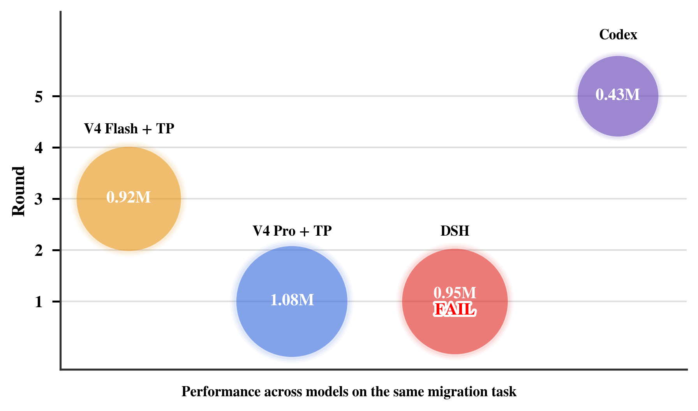
</div>

> 注：圆大小代表消耗的 token 数，轮数指中间校验调整的次数。

<br>

<div align="center">
  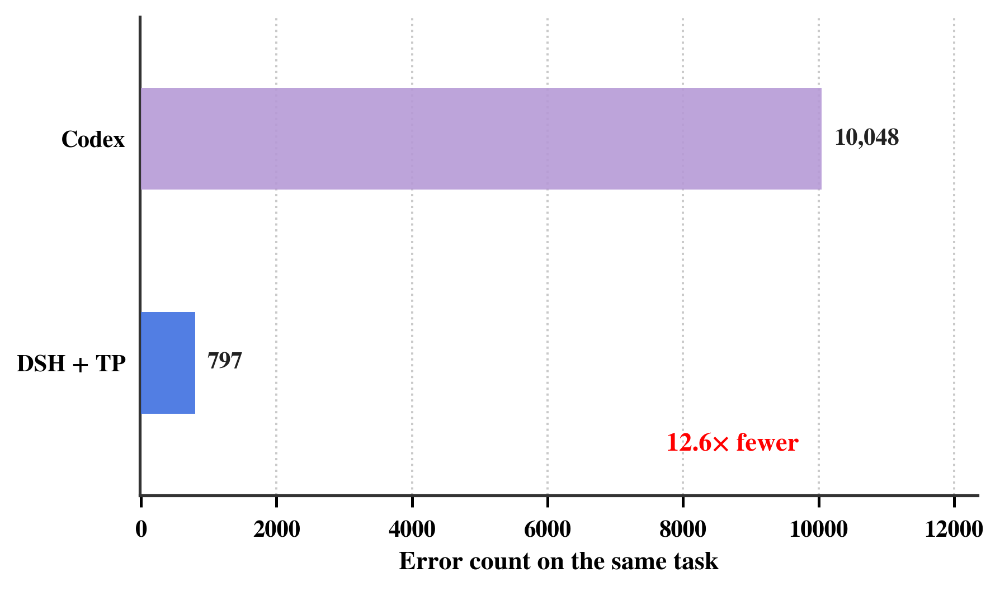
</div>

### 模型可视化

| ViT 注意力/特征 | MAE 重建 |
| --- | --- |
|  | 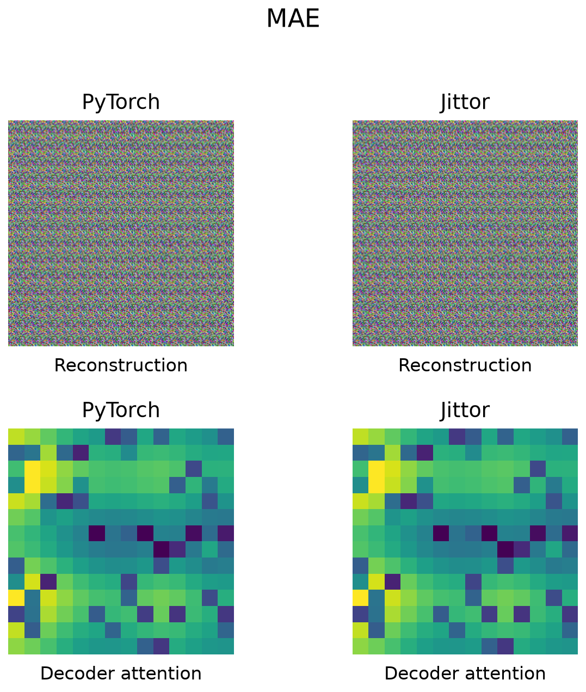 |

| ViT 对齐 | MAE 对齐 |
| --- | --- |
| 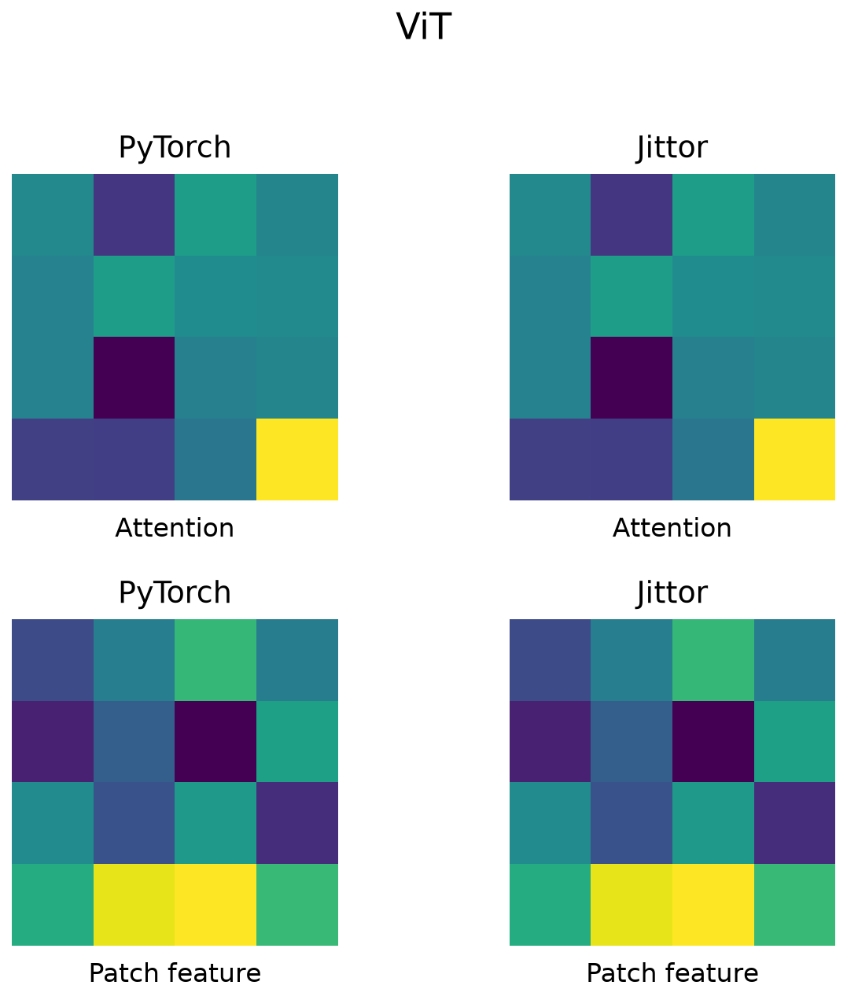 |  |

| Swin 注意力/特征 | ResNet 特征图 |
| --- | --- |
| 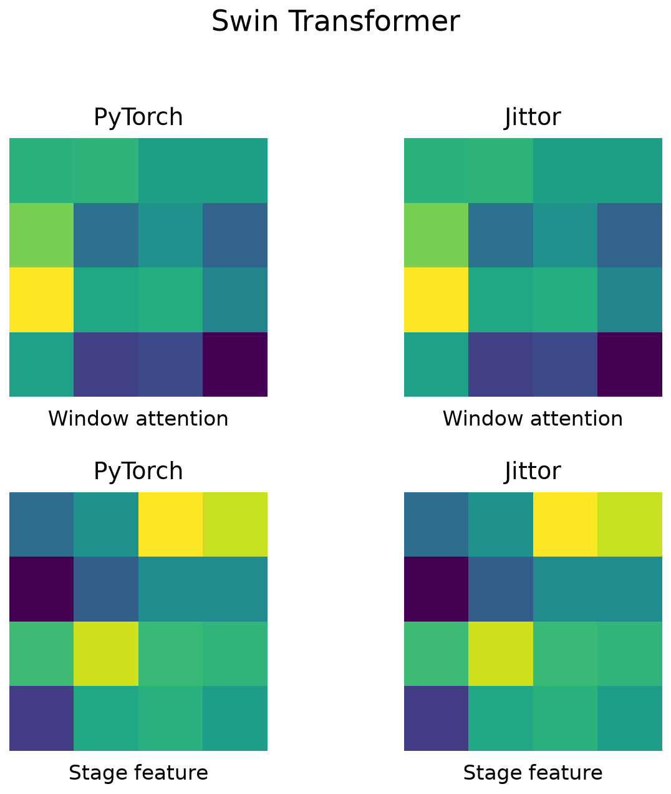 | 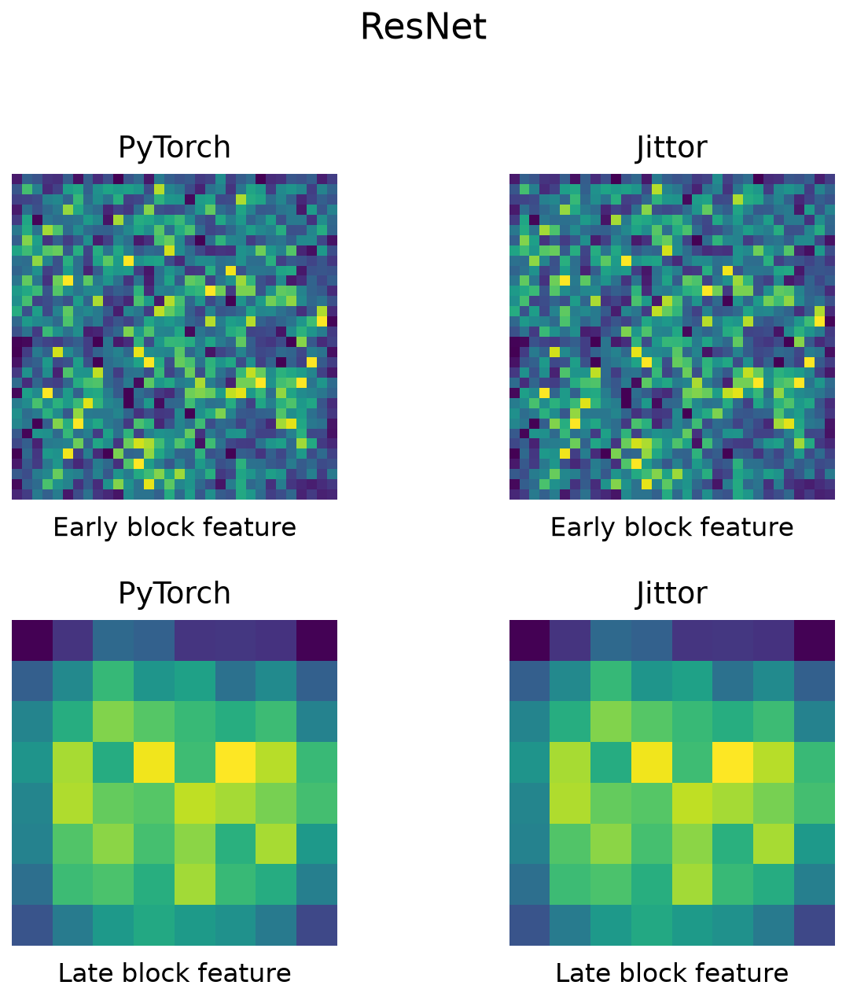 |

| SENet 通道响应 | U-Net 分割证据 |
| --- | --- |
| 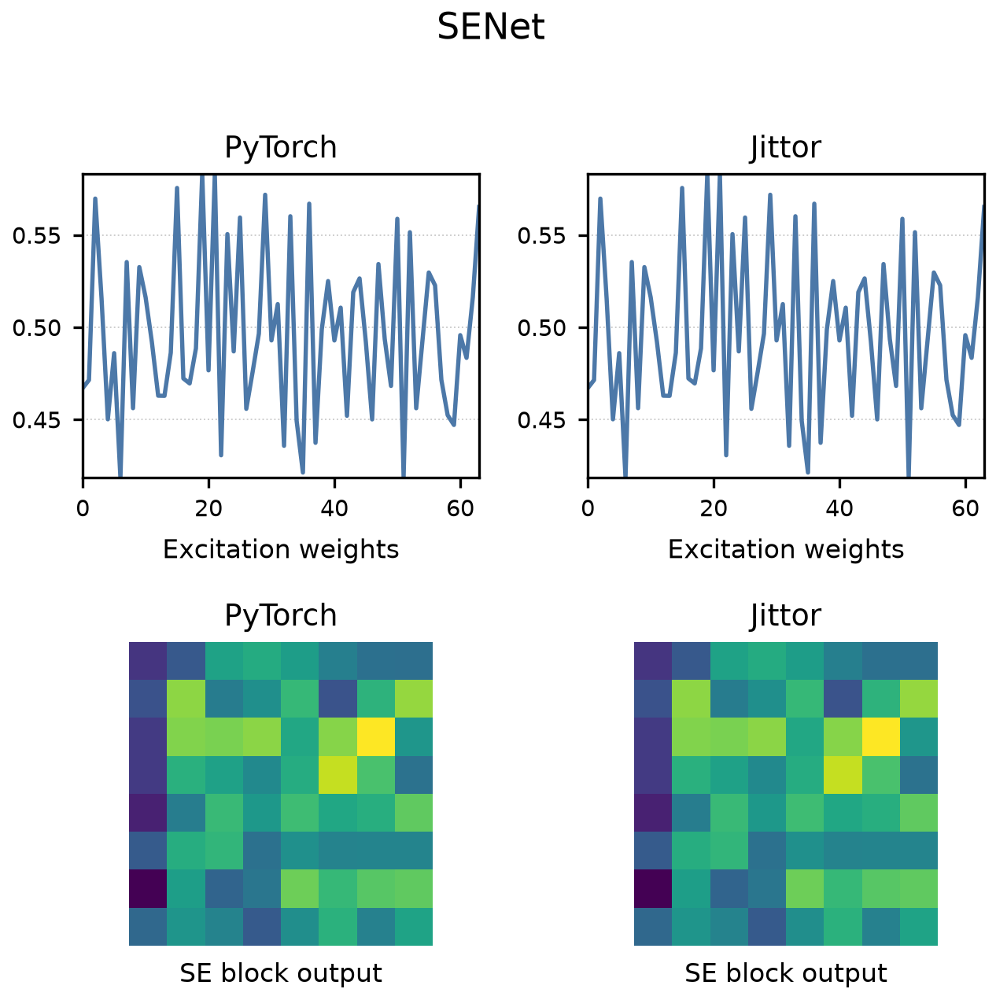 | 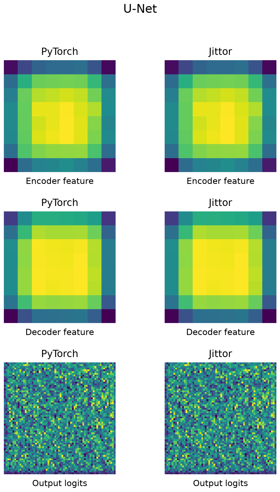 |

| 超分输出 | VAE 潜变量/重建 |
| --- | --- |
| 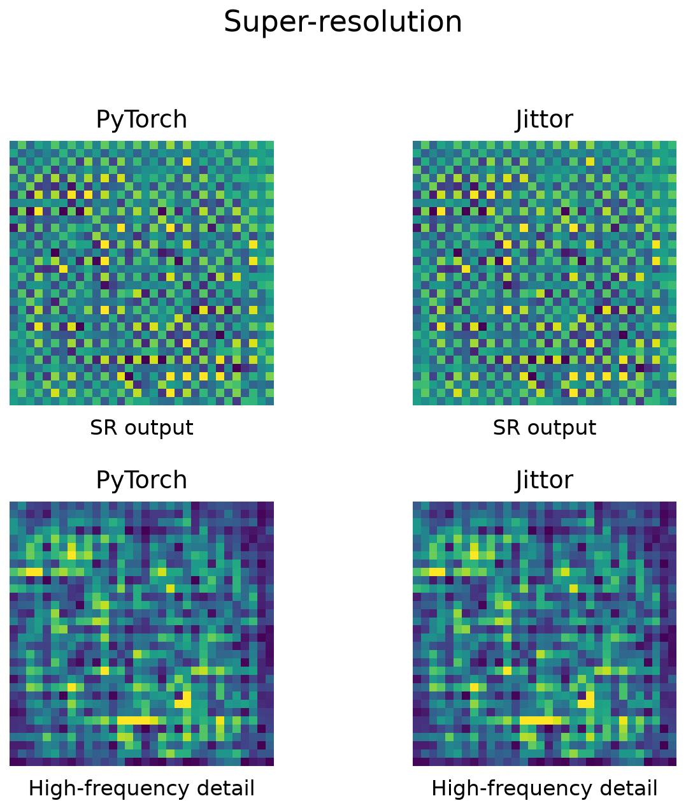 | 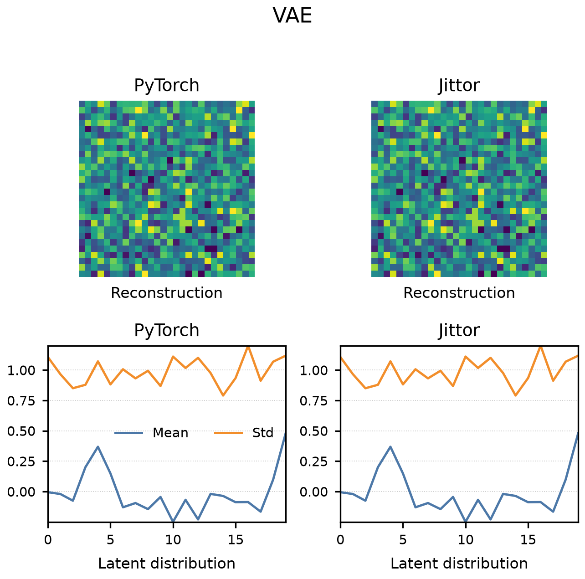 |

## SuperRes DSH 结果

```text
官方转换器：
  CV=true
  RN=false
  failure=jittor.init.orthogonal_ is missing

DSH + TorchPort：
  CV=true
  RN=true
  NA=true
  SA=false
  FD=conv3
```

这个样本说明两点。第一，迁移后的 Jittor 项目可以运行，最终 FP32 输出通过数值对齐。第二，更严格的中间层检查仍在 `conv3` 记录到轨迹级分歧。TorchPort 不把这类分歧隐藏掉，而是写入证书，供后续修复或人工审查。

## 目录结构

```text
src/torchport/       Python 核心与命令行
integrations/dsh/    DSH 插件
benchmarks/          入口模式与仓库基准
compatibility/       兼容性说明与修复规则
experiments/         实验数据、图表、提示词和报告
docs/                设计文档和图片资源
tests/               单元测试与集成测试
```

## 复现实验图

```bash
python experiments/scripts/build.py
python experiments/figures/fig_e2e/plot.py
python experiments/figures/fig_rounds/plot.py
```

架构图提示词：

```text
experiments/prompts/architecture.md
```

## 开源协议

Apache-2.0，见 `LICENSE`。
