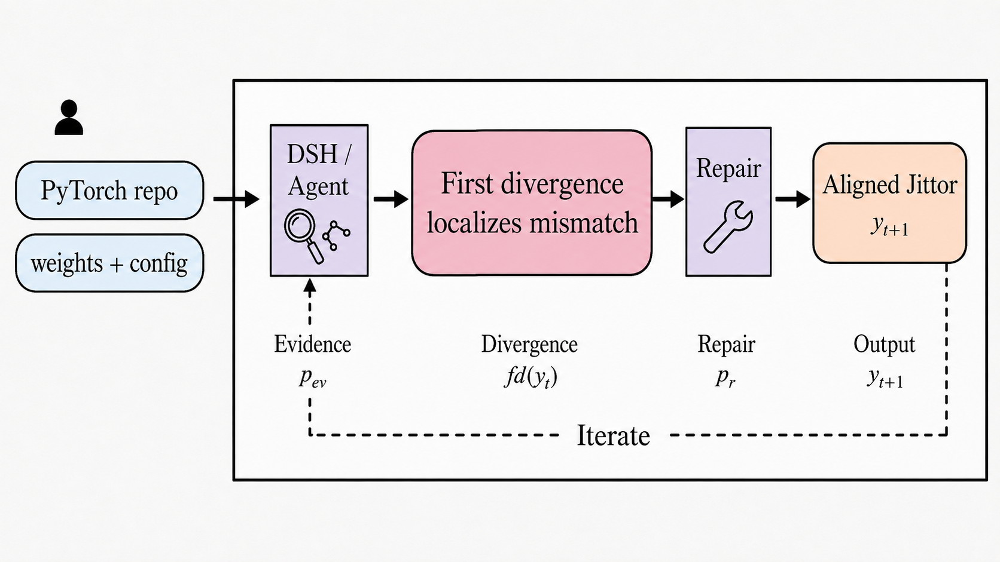

<div align="center">
  <h1>Jittor Harness</h1>

  <p>
    <strong>A PyTorch → Jittor migration and verification system for a domestic-first AI software stack.</strong><br>
    Jittor Harness gives code agents reproducible dual execution, evidence capture, and one frozen
    verification result for repository migrations, currently focused on PyTorch to Jittor.
  </p>

  <p>
    
    
    
    
    
  </p>

  <p>
    <a href="README.md">中文</a> ·
    English
  </p>

  <p>
    <a href="#architecture">Architecture</a> ·
    <a href="#positioning">Positioning</a> ·
    <a href="#quick-start">Quick Start</a> ·
    <a href="#figures">Figures</a> ·
    <a href="#status">Status</a>
  </p>
</div>

Jittor Harness is the public project name. To preserve compatibility with existing tasks and
scripts, the Python package and CLI remain `torchport`; in this document, TorchPort refers to the
execution and numerical-verification core inside the Harness.

## Architecture

<div align="center">
  
</div>

Jittor Harness starts from a narrow requirement: migration should be judged by execution and numerical behavior, not by whether source text has been rewritten.

The system has two layers. An external code agent reads an unknown PyTorch repository, writes the Jittor candidate, and chooses repairs. TorchPort executes a frozen task, checks inputs and parameters, compares numerical results, and returns auditable evidence. The next phase will curate reproduced migration issues as read-only evidence for agents working on unseen tasks.

## Positioning

Jittor Harness is not a collection of model-specific adapters, and it is not a one-pass conversion script. It addresses a reproducible migration question:

```text
Given an unknown PyTorch repository,
can a migration agent submit a Jittor candidate,
run both PyTorch and Jittor with the same input and weights,
compare numerical outputs and intermediate traces,
localize the first divergence when alignment fails,
and record the repair process?
```

This gives each component a clear role:

- A general code agent handles repository-specific understanding, including entry points, configs, weights, and inference paths.
- TorchPort produces auditable engineering evidence, including execution logs, tensor traces, and numerical certificates.
- Jittor is the current domestic target framework with the most complete verification path.
- Ascend-class accelerators are a backend target for later integration under the same evidence chain.

## Domestic Stack Path

TorchPort treats the domestic conversion platform as a sequence of verifiable layers:

| Layer | Current choice | Role |
| --- | --- | --- |
| Agent interface | general code agent | Read unknown repositories and choose migration or repair actions |
| Target framework | Jittor | Receive migrated PyTorch code and weights |
| Verification | dual execution + tensor traces | Decide whether the migration result is trustworthy |
| Backend direction | Ascend-class domestic accelerators | Shape the deployment interface and future backend work |

The current public evidence focuses on PyTorch-to-Jittor migration and numerical verification. Full Ascend-class backend experiments are part of the next backend-integration stage.

## Why Jittor Harness

Most converters ask:

```text
Can the code be converted?
```

Jittor Harness asks:

```text
Does the migrated project run?
Did it load the same weights?
Did it receive the same input?
Are the final outputs numerically aligned?
If not, where does the first layer/operator-level divergence occur?
```

The README uses the following short metrics:

| Metric | Meaning |
| --- | --- |
| `RN` | The migrated Jittor project runs |
| `NA` | Final PyTorch/Jittor outputs are numerically aligned |
| `SA` | Intermediate traces pass a stricter alignment check |
| `FD` | First numerical divergence |
| `Cert` | A numerical certificate with inputs, weights, traces, errors, and failure attribution |

## Quick Start

```bash
python -m venv .venv
. .venv/bin/activate
python -m pip install -e ".[dev]"
```

Run basic checks:

```bash
pytest tests -q
ruff check src tests benchmarks experiments/harness
python -m build
```

Inspect an explicit task first:

```bash
PYTHONPATH=src python -m torchport inspect benchmarks/tasks/tiny/task.yaml
```

`benchmarks/tasks/tiny/task.yaml` shows the complete dual-environment task structure, but its
Python paths belong to the experiment host and are not portable defaults. Copy it, replace
`source.python`, `target.python`, and the devices with the actual environments, then verify it:

```bash
PYTHONPATH=src python -m torchport verify path/to/local-task.yaml \
  --root .torchport/harness \
  --trial t0
```

Execution and evaluation can also be invoked separately:

```bash
PYTHONPATH=src python -m torchport run task.yaml target --root .torchport/harness --trial t0
PYTHONPATH=src python -m torchport evaluate task.yaml path/to/manifest.json \
  --root .torchport/harness --trial t0
PYTHONPATH=src python -m torchport inspect task.yaml
PYTHONPATH=src python -m torchport trace task.yaml --root .torchport/harness --trial t0
PYTHONPATH=src python -m torchport localize .torchport/harness/trace/t0.json
```

The verification result is written to:

```text
.torchport/harness/verify/t0.json
```

## Workflow

```text
Code agent reads the repository and edits the candidate
      -> explicit task
      -> PyTorch/Jittor dual execution
      -> weight and input checks
      -> final-output and optional-trace comparison
      -> first-divergence localization
      -> Agent repair
      -> repeated independent verification
      -> numerical certificate
```

TorchPort does not scan and rewrite unknown repositories. An external code agent owns repository-specific decisions; TorchPort accepts an explicit task and returns structured evidence.

A formal candidate is a complete Git repository. The Agent keeps its own file, Shell, Python, test,
and network tools; the Harness only adds six TorchPort feedback tools. At the end, the Harness saves
a full repository snapshot, file manifest, and Git diff, then runs hidden `verify` against the frozen
snapshot. `run.py` is only the standard entry, not the entire migrated implementation.

## Status

- [x] Explicit TaskSpec plus frozen oracle and candidate identities
- [x] PyTorch/Jittor dual execution, tensor evidence, and one verification result
- [x] First-divergence localization and structured failure codes
- [x] CLI, Harness, and a mature code-Agent repair loop
- [x] P2 feedback gateway, full-repository delivery, cost aggregation, and tiny GPU smoke loop
- [x] CamoFormer numerical verification, repeatability, and reduction-mechanism evidence
- [ ] P3 evidence-backed migration issue library with evaluation on held-out cases
- [ ] Freeze a unified mature-code-Agent benchmark across TorchPort feedback conditions
- [ ] Expand the unseen real PyTorch repository test set
- [ ] Complete end-to-end validation on Ascend-class domestic accelerators
- [ ] Stabilize the CLI, Harness tool contract, documentation, and release flow

Note: current public evidence focuses on PyTorch/Jittor migration and numerical verification. Ascend-class accelerator support is already part of the backend design, but full end-to-end validation remains a TODO item.

## Current Experiment Materials

- `experiments/p2/`: feedback conditions, budgets, held-out tasks, and run records.
- `experiments/figures/fig_e1_ratio/`: E1 noise-calibration ratios.
- `experiments/figures/fig_fixed_tolerance/`: fixed tolerances, runtime variation, and error amplification.
- `experiments/figures/fig_jittor_atomic/`: mechanism evidence for Jittor reduction nondeterminism.

## Layout

```text
src/torchport/          trusted execution, evidence, oracle, comparison, and verification core
benchmarks/             small repository fixtures, task specs, and entry-pattern benchmarks
compatibility/          historical compatibility rules and evidence-backed migration issues
experiments/            experiment data, figures, prompts, and reports
migrations/             real-repository migration protocols, local workspaces, and repository evidence
scripts/                installation, reproduction, and remote development tools
docs/                   architecture, roadmap, and development notes
tests/                  unit and integration tests
```

See [Project Layout](docs/project-layout.md) for ownership rules, generated artifacts, and the
boundary between the two Python packages.

## Reproduce Figures

```bash
python experiments/figures/fig_e1_ratio/plot.py
python experiments/figures/fig_fixed_tolerance/plot.py
python experiments/figures/fig_jittor_atomic/plot.py
```

Architecture prompt:

```text
experiments/prompts/architecture.md
```

## License

Apache-2.0. See `LICENSE`.
