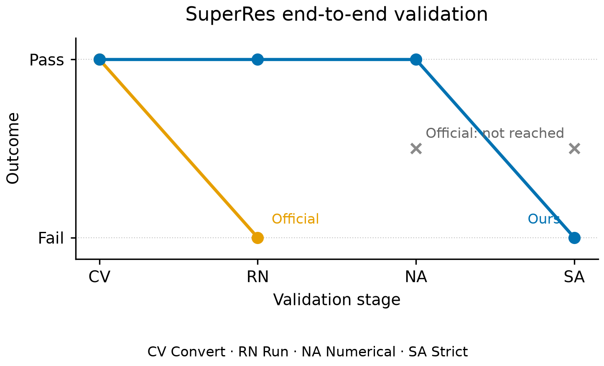
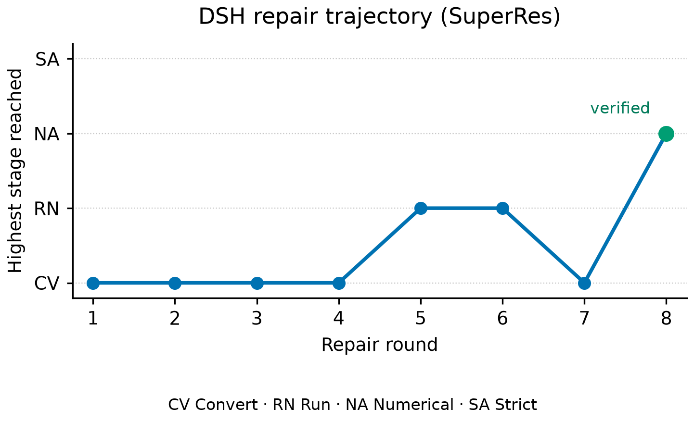
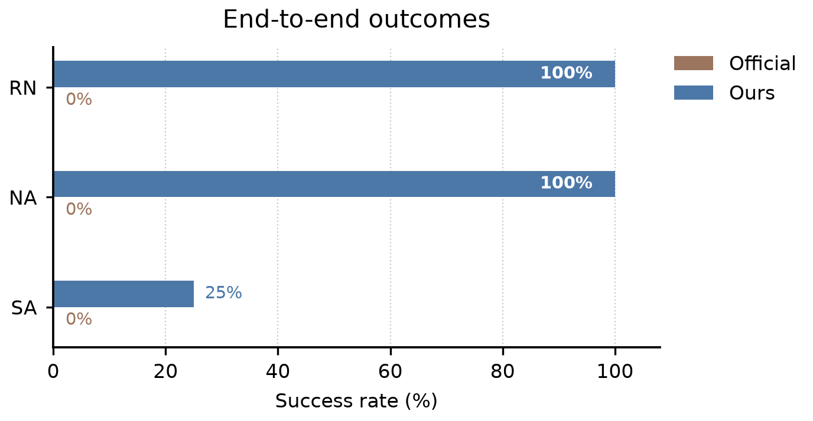
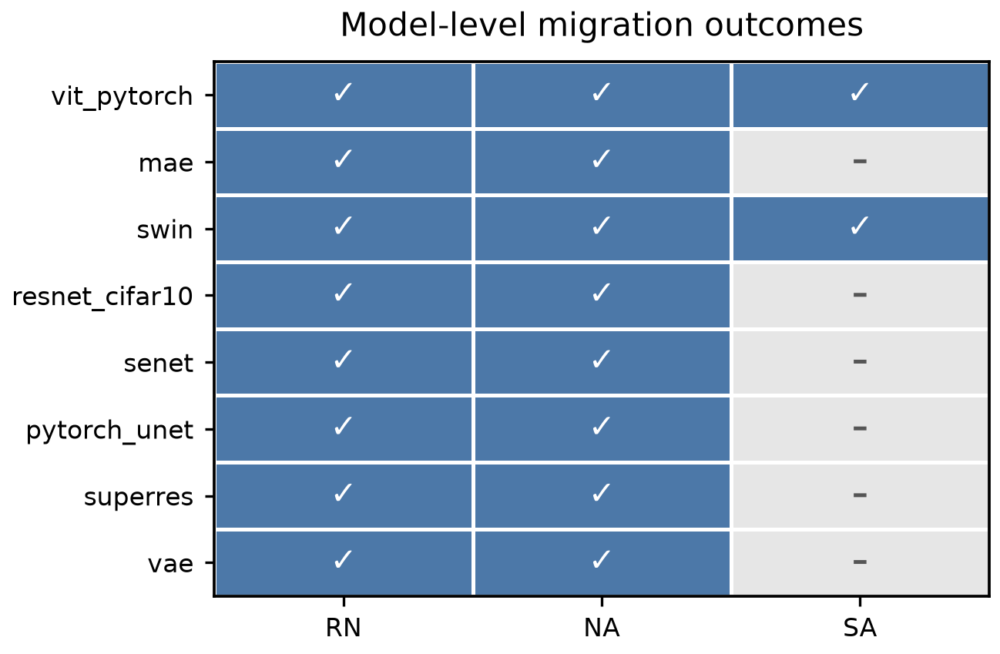
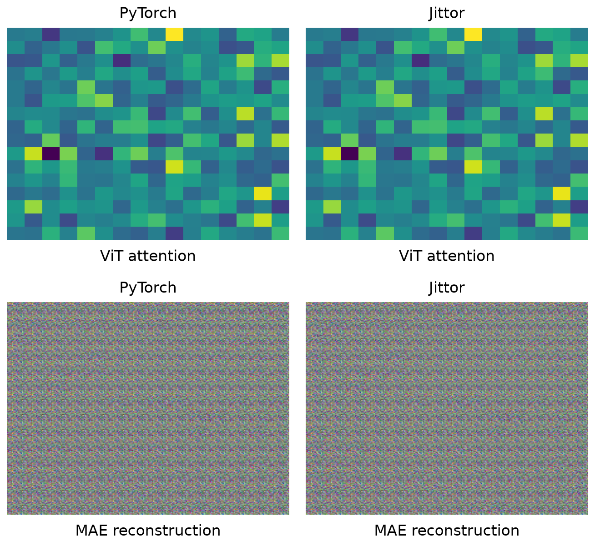
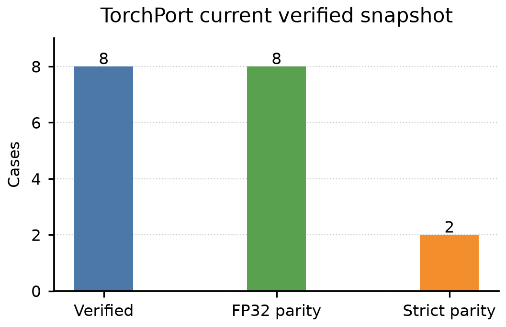
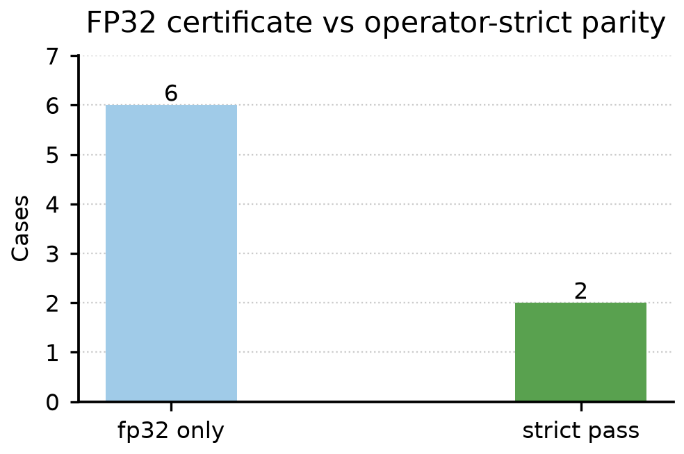
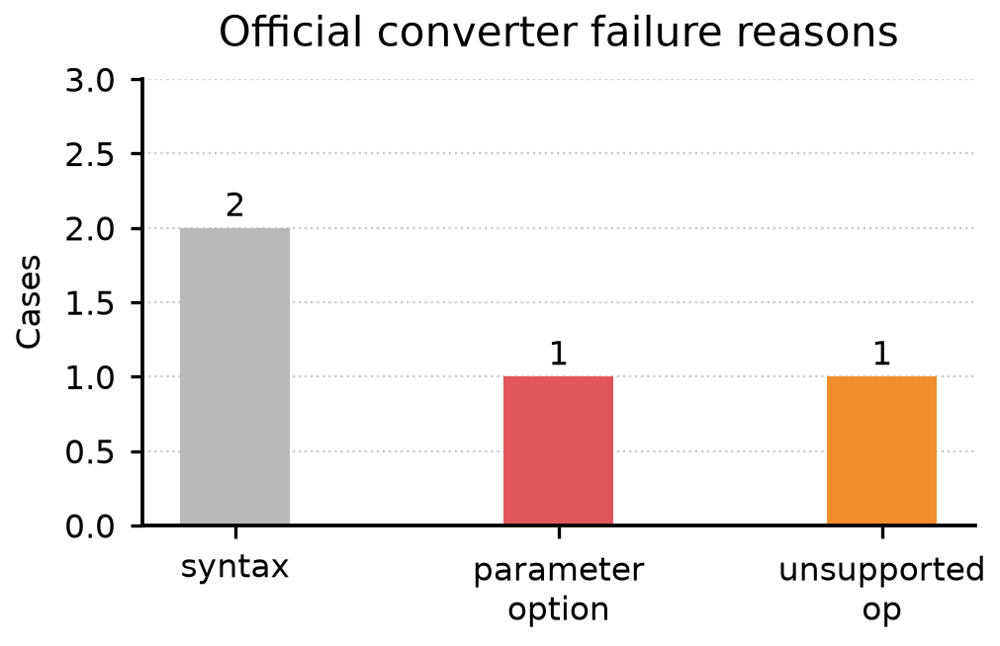
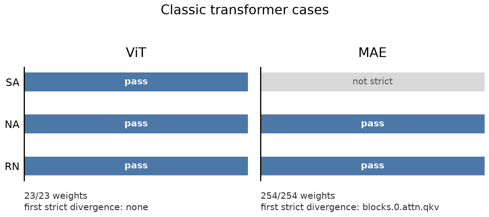
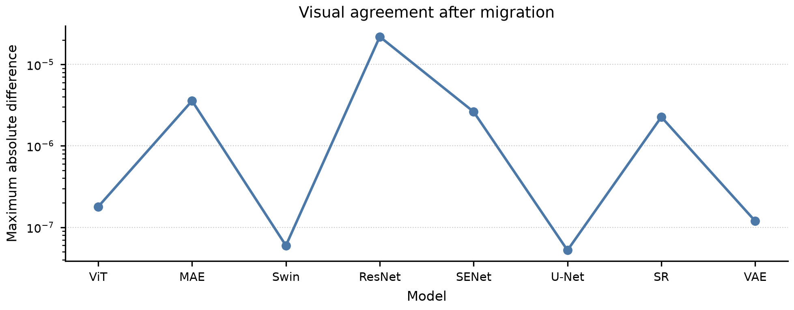

<div align="center">
  

  <h1>TorchPort</h1>

  <p>
    <strong>基于 DeepSeek 的证据驱动全国产化 AI 框架迁移平台。</strong><br>
    面向 PyTorch 研究仓库，自动迁移到 Jittor，并通过真实执行、数值证据、修复闭环和
    昇腾等国产算力天然适配接口完成验证。
  </p>

  <p>
    
    
    
    
    
    
  </p>

  <p>
    <a href="#快速开始">快速开始</a> ·
    <a href="#工作流">工作流</a> ·
    <a href="#dsh-集成">DSH 集成</a> ·
    <a href="#实验图表">实验图表</a> ·
    <a href="#当前状态">当前状态</a> ·
    <a href="README.md">English README</a>
  </p>
</div>

## 系统架构

<div align="center">
  
</div>

TorchPort 的定位是全国产化转换平台：DeepSeek 负责仓库级理解和决策，DSH 负责任务调度与
修复闭环，Jittor 是当前核心国产目标框架，昇腾等国产算力是天然适配的部署目标。系统不是
盲目改代码，而是用双端执行、数值轨迹和首次数值分歧定位来约束迁移质量。

## 项目定位

TorchPort 是一个基于 DeepSeek/DSH 的全国产化 AI 迁移平台。当前第一条主线是
PyTorch 到 Jittor，架构上面向昇腾等国产算力后端扩展。项目不是简单的代码替换器，也不是
按模型名堆出来的适配器集合，而是把迁移定义成一个可验证、可定位、可修复的闭环：

```text
未知 PyTorch 仓库
        -> DeepSeek/DSH 理解仓库
        -> TorchPort 迁移并双端执行 PyTorch/Jittor
        -> 比较中间张量轨迹
        -> 定位首次数值分歧点
        -> DSH 根据证据修复
        -> 生成经过验证的 Jittor 仓库
```

职责边界：

- DeepSeek/DSH 负责面对未知仓库做动态决策。
- TorchPort 负责提供确定性工具和可复验证据。
- Jittor 是当前主要国产目标框架。
- 昇腾等国产算力适配是平台级一等目标，不是后期外挂。

## 为什么需要 TorchPort

普通转换器主要回答：

```text
代码能不能改过去？
```

TorchPort 要回答更严格的问题：

```text
迁移后的项目是否真的能运行？
是否加载了相同权重？
是否使用了相同输入？
PyTorch 和 Jittor 的数值行为是否一致？
如果不一致，第一次从哪里开始不一致？
```

核心指标：

- `RN`：迁移后的 Jittor 项目是否真正运行。
- `NA`：PyTorch/Jittor 最终输出是否数值对齐。
- `SA`：更严格的中间层对齐是否通过。
- `First divergence`：首次出现明显数值分歧的层或算子。
- `Certificate`：包含输入、权重、轨迹、误差和失败归因的可复验证书。

## 快速开始

```bash
python -m venv .venv
. .venv/bin/activate
python -m pip install -e ".[dev]"
```

运行测试：

```bash
pytest tests -q
ruff check .
python -m build
```

扫描并规划 PyTorch 仓库：

```bash
PYTHONPATH=src python -m torchport scan /path/to/pytorch-repo
PYTHONPATH=src python -m torchport plan /path/to/pytorch-repo --target jittor-native
```

执行自动迁移和验证：

```bash
PYTHONPATH=src python -m torchport auto /path/to/pytorch-repo \
  --output /path/to/migrated-jittor \
  --target jittor-native \
  --entrypoint main.py \
  --model main.Model \
  --shape 1,3,224,224 \
  --check-run
```

主报告位置：

```text
/path/to/migrated-jittor/.torchport/auto.json
```

## 工作流

```text
仓库扫描
      -> 模型入口恢复
      -> 代码迁移
      -> 源端/目标端执行
      -> 权重与输入检查
      -> 张量轨迹比较
      -> 首次数值分歧定位
      -> 修复建议
      -> 再验证
      -> 数值证书
```

这条闭环是 TorchPort 和静态转换脚本的核心区别。模型知识不写死在
`resnet_adapter.py`、`vit_adapter.py` 这类文件里，而是由 DSH 阅读仓库、结合 TorchPort
证据决定下一步动作。

## DSH 集成

DSH 插件位于 `integrations/dsh`，提供 8 个结构化工具：

```text
scan_repository
create_migration_plan
start_migration
run_verification
locate_first_divergence
propose_repairs
apply_verified_repair
generate_certification_report
```

运行插件测试：

```bash
cd integrations/dsh
npm install
npm test
```

## 当前状态

已经实现：

- 仓库扫描和模型入口恢复；
- PyTorch 到原生 Jittor 的迁移骨架；
- PyTorch/Jittor 双端受控执行；
- 权重迁移完整性检查；
- 中间张量轨迹采集；
- FP32 与 strict 两档数值比较；
- 首次数值分歧定位；
- 结构化失败分类；
- DSH 插件和修复/验证循环；
- 实验脚本和论文风格图表。

证据边界：

- 当前正式 DSH 端到端样本是 PyTorch examples SuperRes。
- 历史双端证书和可视化覆盖了多类模型。
- 官方转换器、JTorch、纯 Codex、纯 DSH、DSH + TorchPort 的大规模统一对比仍需要冻结实验。
- 昇腾等国产算力是平台接口和适配方向；当前公开证据主要集中在 PyTorch/Jittor 迁移与数值验证。

## 实验图表

### 主实验图

| 端到端对比 | DSH 修复轨迹 |
| --- | --- |
|  |  |

| 方法概览 | 模型覆盖快照 |
| --- | --- |
|  |  |

| 张量证据 | 状态分布 |
| --- | --- |
|  |  |

| Strict 对齐 | 失败归因 |
| --- | --- |
|  |  |

### 模型可视化

| ViT 注意力/特征 | MAE 重建 |
| --- | --- |
|  |  |

| ViT/MAE 总览 | ViT 对齐 |
| --- | --- |
|  |  |

| MAE 对齐 | Swin 注意力/特征 |
| --- | --- |
|  |  |

| ResNet 特征图 | SENet 通道响应 |
| --- | --- |
|  |  |

| U-Net 分割证据 | 超分输出 |
| --- | --- |
|  |  |

| VAE 潜变量/重建 | 可视化总览 |
| --- | --- |
|  |  |

## SuperRes DSH 结果

```text
官方转换器：
  CV=true
  RN=false
  failure=jittor.init.orthogonal_ is missing

DSH + TorchPort：
  CV=true
  RN=true
  NA=true
  SA=false
  first strict divergence=conv3
```

这说明迁移后的 Jittor 项目能够运行，最终 FP32 输出对齐通过。更严格的中间层检查仍在
`conv3` 留下轨迹级分歧，TorchPort 会把它记录到证书中，而不是隐藏掉。

## 目录结构

```text
src/torchport/       Python 核心与命令行
integrations/dsh/    DSH 插件
benchmarks/          入口模式与仓库基准
compatibility/       兼容性说明与修复规则
experiments/         实验数据、图表、提示词和报告
docs/                设计文档和图片资源
tests/               单元测试与集成测试
```

## 复现实验图

```bash
python experiments/scripts/build.py
python experiments/figures/fig_e2e/plot.py
python experiments/figures/fig_rounds/plot.py
```

方法图生成提示词：

```text
experiments/prompts/architecture.md
```

## 开源协议

Apache-2.0，见 `LICENSE`。
